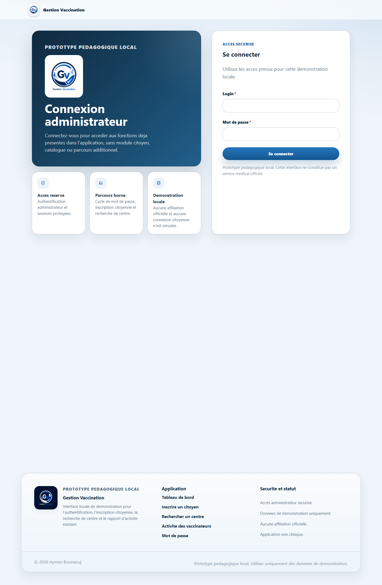
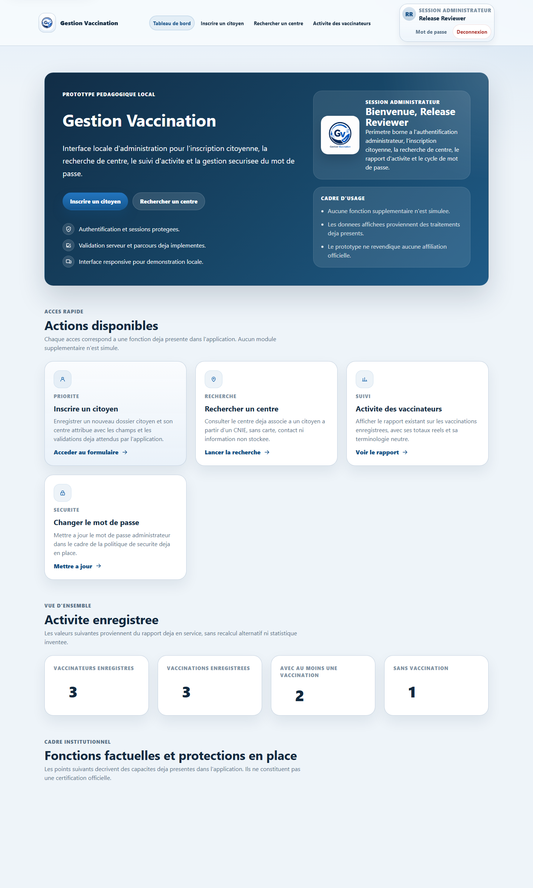
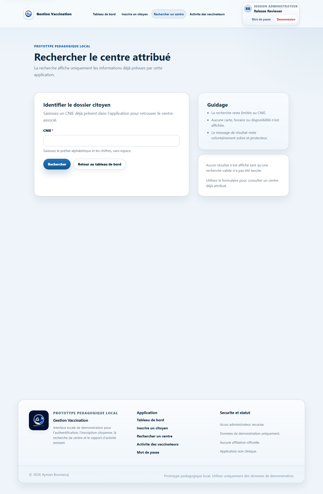

# Gestion Vaccination

Gestion Vaccination is a local educational PHP and MariaDB prototype for secure administrator login, citizen registration, assigned vaccination-centre lookup, vaccinator activity reporting, and password-change enforcement.

## Release status

- Confirmed: this repository is prepared as release candidate `v0.1.0`.
- Confirmed: the application interface language is French.
- Confirmed: the public documentation language is English.
- Unresolved limitation: `VACCINATION_BASE_PATH` is hard-coded to `/gestion_vaccination`, so the local web path must match that route prefix unless you adapt it privately outside this release candidate.

## Confirmed capabilities

- Secure administrator authentication
- Forced password replacement
- Password change with policy enforcement
- Session hardening and CSRF protection
- Login throttling and authentication security-event logging
- Citizen registration
- Assigned vaccination-centre lookup by CNIE
- Vaccinator activity reporting
- Responsive shared layout
- Permanent isolated PHPUnit test suite
- GitHub Actions CI workflow

## Confirmed non-features

This project does not currently provide:

- Patient accounts
- Appointment booking
- Vaccine stock management
- Vaccination certificates
- Campaign management
- Interactive maps
- Medical recommendations
- Side-effect reporting
- Government integration
- Clinical validation

## Repository structure

- `config/`: shared application, layout, database-connection, reporting, and security code
- `pages/`: public PHP entry points
- `assets/`: CSS, JavaScript, and branding assets
- `database/schema.sql`: public schema-only bootstrap
- `database/demo/`: optional synthetic demonstration seed
- `scripts/create_admin.php`: CLI helper for creating the first administrator
- `tests/`: permanent isolated PHPUnit suite
- `docs/`: public project documentation

## Quick start

1. Read [docs/installation.md](docs/installation.md).
2. Apply `database/schema.sql` to a local MariaDB database.
3. Optionally load `database/demo/seed-demo.sql`.
4. Create the first administrator with `php scripts/create_admin.php`.
5. Run `composer test`.
6. Open `/gestion_vaccination/pages/authentification.php`.

## Public screenshots

All screenshots committed in `docs/screenshots/` were generated from an isolated synthetic test environment.

## Documentation map

- Installation: [docs/installation.md](docs/installation.md)
- Architecture: [docs/architecture.md](docs/architecture.md)
- Database: [docs/database.md](docs/database.md)
- Security: [docs/security.md](docs/security.md)
- Privacy and demo data: [docs/privacy-and-demo-data.md](docs/privacy-and-demo-data.md)
- User guide: [docs/user-guide.md](docs/user-guide.md)
- Testing: [docs/testing.md](docs/testing.md)
- Project history: [docs/project-history.md](docs/project-history.md)

## Confirmed local verification

- Confirmed: `composer test` passes locally.
- Confirmed: the release artifacts were rehearsed against an isolated MariaDB database with synthetic data only.
- Unresolved limitation: this README does not claim hosted deployment, production readiness, or a managed upgrade path.
